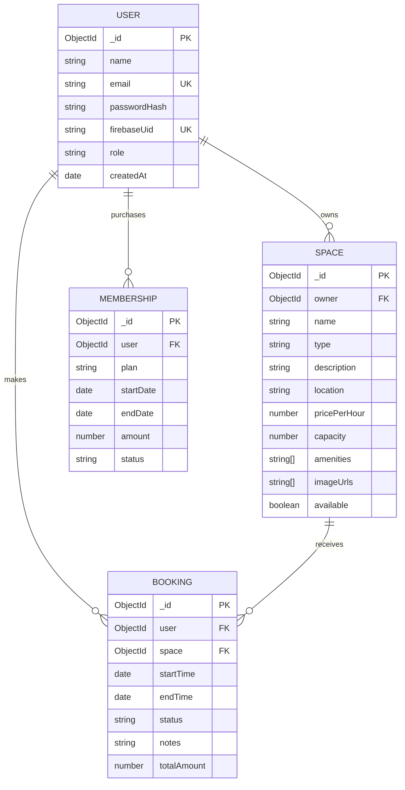

# DeskShare ER Diagram

## Relationship Summary

- One user/owner can own many spaces.
- One user can make many bookings.
- One space can receive many bookings.
- One user can purchase many memberships.
